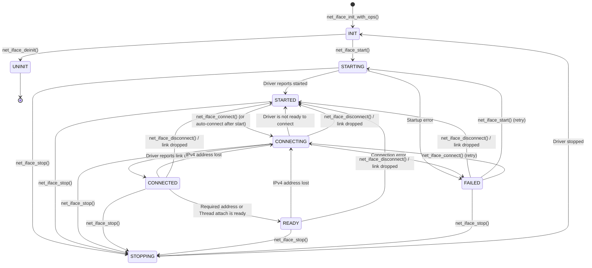
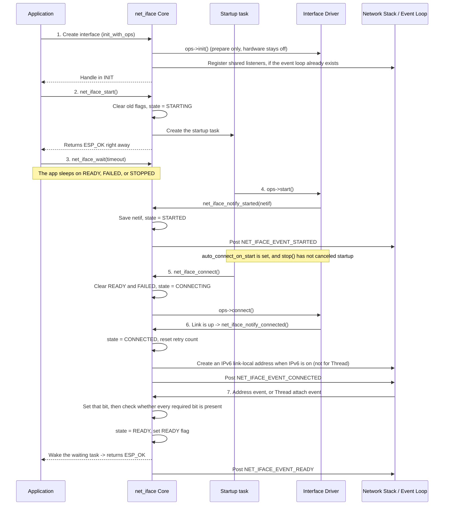
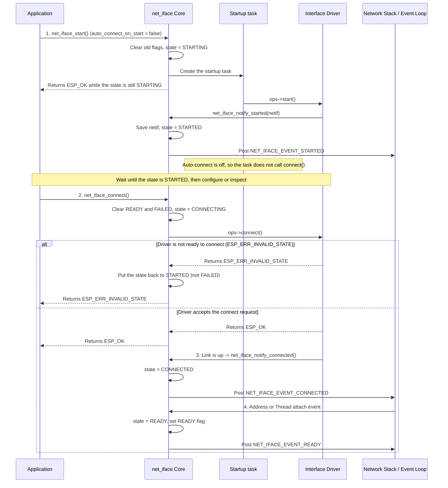
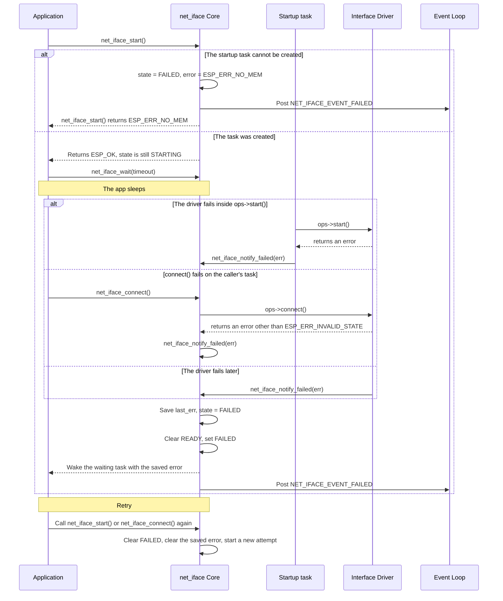
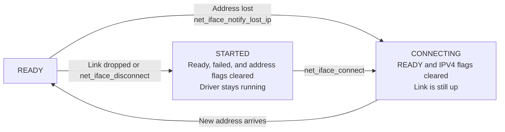
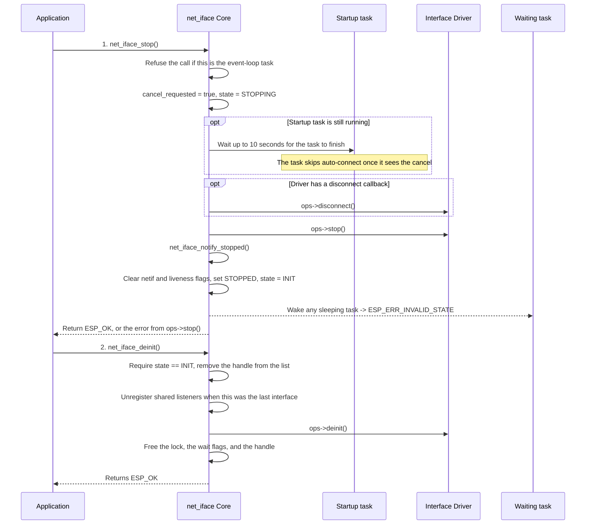
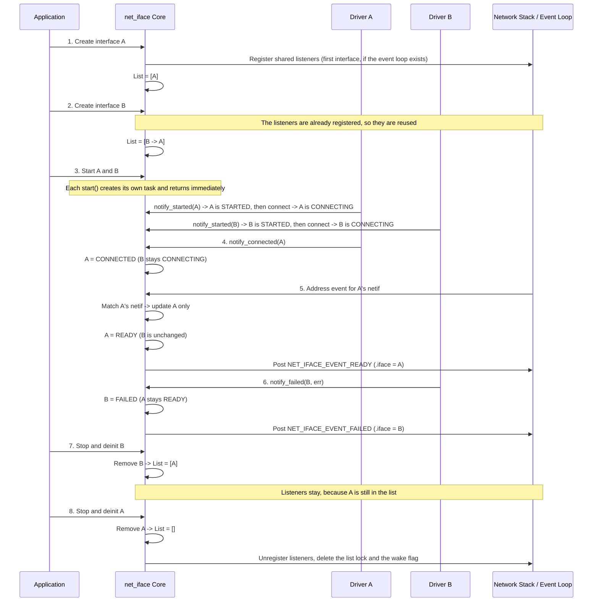

# Generic Network Interface Flow (`net_iface`)

This document explains how a network interface is managed from creation to cleanup. It applies to every interface type. It shows how the interface core, the driver, the network stack, and the application work together.

---

## 1. Core Idea

The interface manager keeps one record for every network interface the application creates.

Drivers do not track readiness on their own, and they do not wake waiting tasks on their own. They report progress to this manager. The network stack reports address changes to the same manager. For Thread, joining the network is the report that matters.

From those reports, the manager keeps three things for each interface:

1. **Current state:** Where the interface is in its life (`INIT`, `STARTING`, `STARTED`, `CONNECTING`, `CONNECTED`, `READY`, `FAILED`, `STOPPING`, `UNINIT`).
2. **Wait flags:** Status bits (`READY`, `FAILED`, `STOPPED`, and address or attachment bits) that stay set until a later start, connect, disconnect, or stop clears them. `net_iface_wait()` sleeps on these bits.
3. **Events:** `NET_IFACE_EVENT` notices posted on the system event loop, so an application can react without blocking.

`net_iface_start()` does not do the driver's work itself. It marks the interface `STARTING`, creates one startup task for that interface, and returns. The startup task turns the driver on. If `auto_connect_on_start` is set, that same task then asks the driver to connect.

---

## 2. Interface States at a Glance

### What each state means

- **`UNINIT`:** The handle does not exist, or it has been destroyed.
- **`INIT`:** The handle exists and its settings are stored, or it has been cleanly stopped. The hardware is off.
- **`STARTING`:** `net_iface_start()` has returned. A background task is turning the driver on and creating the network interface object.
- **`STARTED`:** The driver is up and idle. There is no active link yet.
- **`CONNECTING`:** The driver is trying to bring the link up, or it is waiting to get an address back after one was lost.
- **`CONNECTED`:** The link is up. The required address, or Thread attachment, is not complete yet.
- **`READY`:** The link is up and every required address is present. For Thread, the device has joined the network. The application can send and receive traffic.
- **`FAILED`:** Startup or connection failed. The error code is saved.
- **`STOPPING`:** Shutdown has started. If the startup task is still running, stop waits for it to finish, then turns the driver off.

---

## 3. Step-by-Step Flows for Different Cases

### Case 1: Normal Happy Path (Create -> Start -> Connect -> Ready)

This is the usual path. The application creates an interface, starts it with auto-connect turned on, the link comes up, and the required address arrives.

**What to remember:**

- Creating a handle only sets up memory, locks, and driver settings. The hardware stays off until the startup task runs.
- `net_iface_start()` returns as soon as the startup task exists. `ESP_OK` means the task was created. It does not mean the driver is up or the network is ready.
- The application can call `net_iface_wait()` as soon as `start()` returns. The wait sleeps until the interface is ready, has failed, or has stopped.
- `CONNECTED` means the lower-level link is up. The interface becomes `READY` only when every required bit is set: IPv4, a preferred IPv6 address when IPv6 was requested, or Thread attachment.
- If both IPv4 and IPv6 are required, the first address sets its own bit and the interface stays `CONNECTED`. It moves to `READY` when the second address arrives.
- Thread does not wait for an IP address. It becomes ready when it joins the network. Thread also creates its own IPv6 addresses, so the core does not create a link-local address for it.

---

### Case 2: Manual Connect (Start without Auto-Connect)

Sometimes the application wants the driver up first, so it can configure or inspect the interface, and connect later. Set `auto_connect_on_start` to false.

1. `net_iface_start()` returns while the state is still `STARTING`.
2. The startup task runs `ops->start()`. The driver calls `net_iface_notify_started()`.
3. The interface stops in `STARTED` and posts `NET_IFACE_EVENT_STARTED`. The startup task does not call `net_iface_connect()`.
4. `net_iface_connect()` is allowed only from `STARTED` or `FAILED`. A connect call made while the state is still `STARTING` returns `ESP_ERR_INVALID_STATE`. Wait for `NET_IFACE_EVENT_STARTED`, or check `net_iface_get_state()`, before connecting.
5. `net_iface_connect()` moves the state to `CONNECTING`, clears the old `READY` and `FAILED` flags, and calls `ops->connect()`.
6. Link-up and address assignment then follow Case 1.

If `ops->connect()` returns `ESP_ERR_INVALID_STATE` (for example, Wi-Fi has no network name yet), the manager puts the state back to `STARTED` and returns that error. It does not mark the interface `FAILED`, so the application can finish configuring it and try again.

A driver with no `connect` callback stays in `CONNECTING` until an address event, or a Thread attach event, arrives.

---

### Case 3: Startup or Connection Failure and Retry

A failure can happen while the startup task is turning the driver on, while `net_iface_connect()` is calling the driver, or later while the driver is still trying to connect.

**What to remember:**

- If the caller passes `ESP_OK` to `net_iface_notify_failed()`, the manager stores `ESP_FAIL`. A failed interface never looks successful.
- Once `FAILED` is set, `net_iface_wait()` returns the saved error immediately. The flag stays set until `start()`, `connect()`, `disconnect()`, or `stop()`.
- From `FAILED`, `net_iface_connect()` retries the link. `net_iface_start()` starts the driver again, but only after the previous startup task has exited.
- `ESP_ERR_INVALID_STATE` from `ops->connect()` is the exception in Case 2. That result goes back to `STARTED` and does not set `FAILED`.

---

### Case 4: Losing an Address vs. Losing the Link

Once an interface is `READY`, two kinds of trouble can happen while the driver stays running.

1. **Address lost (`net_iface_notify_lost_ip`):**
   - The link is still up, but the IPv4 address is gone.
   - This is accepted from `READY` or `CONNECTED`.
   - The manager clears the `READY` and `IPV4` flags, moves the state to `CONNECTING`, and posts `NET_IFACE_EVENT_LOST_IP`.
   - When a new address arrives, the interface can become `READY` again.
2. **Link dropped or manual disconnect (`net_iface_notify_disconnected` / `net_iface_disconnect`):**
   - The connection itself is gone.
   - The manager clears `READY`, `FAILED`, `STOPPED`, and the address and attachment flags.
   - The state moves back to `STARTED`, and `NET_IFACE_EVENT_DISCONNECTED` is posted.
   - The driver stays up, so a later `net_iface_connect()` can try again.

---

### Case 5: Waiting for One Interface (`net_iface_wait`)

`net_iface_wait()` lets a task wait for one interface:

- **Wait before ready:** The task sleeps until `READY`, `FAILED`, or `STOPPED` is set, or the time runs out.
- **Wait after ready:** The flags stay set after the wait returns. A later `net_iface_wait()` on an interface that is already `READY` returns `ESP_OK` at once.
- **Several waiters:** Two or more tasks can wait on the same interface. They all wake up and see the same result.
- **Which flag wins:** If more than one flag is set, the check order is `READY`, then `FAILED`, then `STOPPED`.
- **Timeout:** If none of those flags is set in time, the call returns `ESP_ERR_TIMEOUT`. The interface keeps trying in the background.
- **No time limit:** `timeout_ms` of `UINT32_MAX` waits until the interface is ready, has failed, or has stopped.
- **Nothing to wait for:** If `start()` has never been called, the call returns `ESP_ERR_INVALID_STATE`.
- **Event loop:** A wait on the event-loop task returns `ESP_ERR_INVALID_STATE`. That task has to stay free so the events that finish the wait can run.

### Waiting for several interfaces

`net_iface_wait_all()` and `net_iface_wait_any()` watch a list of interfaces with one shared timeout. They sleep on a single wake flag that is created with the first interface. The flag is set when an interface becomes ready, fails, stops, or when `start()` fails before it can create the startup task.

Both calls refuse an empty list, a null handle, a call from the event-loop task, and an interface that was never started.

- **`net_iface_wait_all()`** returns `ESP_OK` when every interface in the list is ready. If one of them fails, it returns that interface's error immediately. If one of them stops, it returns `ESP_ERR_INVALID_STATE`. The others are left running.
- **`net_iface_wait_any()`** returns `ESP_OK` as soon as one interface is ready. The optional `out_ready` argument receives that handle. One failure does not end the wait while another interface is still trying. When every interface has failed or stopped, it returns the first error it saw, or `ESP_ERR_INVALID_STATE` if they only stopped.
- **One clock:** The timeout covers the whole list. `UINT32_MAX` waits with no time limit. When the time runs out, both calls return `ESP_ERR_TIMEOUT` and leave the interfaces running.
- **No missed wake-up:** Each loop clears the wake flag before it looks at the interfaces. If one of them changes during that look, the flag is set again and the following sleep returns at once.

---

### Case 6: Stopping and Destroying (`net_iface_stop` and `net_iface_deinit`)

**What to remember:**

- `net_iface_stop()` first marks the interface `STOPPING` and asks the startup task to cancel. If that task is still running, stop waits up to 10 seconds for it to leave. If the task does not finish in time, stop logs a warning and continues, so the handle does not stay in `STOPPING`.
- After the startup task has finished, stop calls `ops->disconnect()` whenever the driver has that callback. This covers a link that came up while startup was still running. Then it calls `ops->stop()`.
- Even when `ops->stop()` returns an error, the manager still calls `net_iface_notify_stopped()`. The state returns to `INIT`, and the call returns the driver's error.
- Calling `stop()` on a handle that is already `INIT` or `STOPPING` returns `ESP_OK`.
- While the state is `STOPPING` or `INIT`, late address and driver reports are ignored, so they cannot move the interface back to `READY` or `STARTED`. One exception: if `net_iface_notify_started()` arrives during `STOPPING`, the core still saves the `netif` pointer so the driver's stop can free it. The state stays `STOPPING`.
- `net_iface_deinit()` is allowed only from `INIT`. When the last interface is destroyed, the manager unregisters the shared listeners and deletes the list lock and the shared wake flag.

---

### Case 7: Several Interfaces at Once

An application can create and run two or more interfaces at the same time. They share one manager and one set of listeners. Each interface keeps its own state, lock, wait flags, and startup task.

**How several interfaces are handled:**

1. **Shared listeners, installed once.** Creating the first interface creates the list lock and the shared wake flag, then tries to register the listeners. If the event loop does not exist yet, that attempt does nothing and `net_iface_start()` tries again. Later interfaces are added at the front of the list and reuse the same listeners.
2. **Address events go to the matching interface.** An IP event carries the `netif` that gained or lost the address. The shared handler walks the list, finds the handle with that `netif`, and updates only that handle. Events for a `netif` this manager does not own are ignored. A Thread attach event does not name a `netif`. The handler updates the Thread interface, and only one Thread interface is supported.
3. **Independent state and waits.** Each interface has its own lock and its own wait flags. One task can wait on interface A while another waits on interface B. B failing or stopping does not change A. Every `NET_IFACE_EVENT` carries `.iface`, `.netif`, and `.type`, so one application handler can tell which interface posted it.
4. **Lookup and iteration.**
   - `net_iface_get_by_type(type)` returns the first interface of that type. Because new interfaces are added at the front, that is the one created most recently.
   - `net_iface_get_by_desc(desc)` returns the interface whose description matches the string given at creation.
   - `net_iface_for_each(cb, ctx)` copies the list under the list lock, releases the lock, then calls the callback for each interface.
5. **Cleanup when the last interface is gone.** Destroying one interface removes only that handle. The shared listeners stay up for the ones that remain. When the last interface is destroyed, `net_iface_deinit()` unregisters the listeners and deletes the list lock and the shared wake flag.

---

## 4. Concurrency Rules

Application tasks, driver callbacks, and the system event loop all touch the same records. The manager follows four rules so they do not deadlock.

1. **Two locks, always in the same order.** There is one list lock and one lock per interface. When both are needed, the list lock is taken first.
2. **Release locks before calling out.** The manager releases its locks before it calls a driver (`init`, `start`, `connect`, `disconnect`, `stop`, `deinit`), before it registers or unregisters event handlers, and before it posts an event. A driver callback or an application event handler can then call `net_iface_get_state()` and the other read APIs safely. `net_iface_start()` holds the interface lock only while it creates the startup task, so that task cannot clear its task handle before the handle has been saved. The driver runs after that lock is released.
3. **Do not block the event loop.** The first `NET_IFACE_EVENT`, IP event, or Thread event records which task is the event loop. `net_iface_wait()`, `net_iface_wait_all()`, `net_iface_wait_any()`, and `net_iface_stop()` return `ESP_ERR_INVALID_STATE` when they are called from that task. Blocking it would stop the events those calls are waiting for.
4. **Copy the list before iterating.** `net_iface_for_each()` takes the list lock, copies the interface pointers, and releases the lock before it calls the user's callback. The callback must not destroy an interface that is still in that copy.
